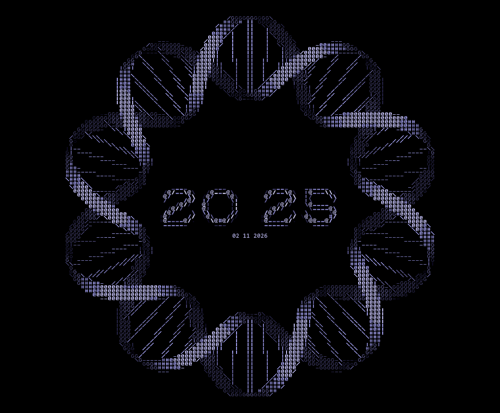

# ASCII Background

An ASCII-art desktop for Windows: a wallpaper of DNA helices with a
[Rainmeter](https://www.rainmeter.net/) clock in the middle, drawn from matching
ASCII-art digits. When a digit changes it dissolves into the next one, cell by
cell, instead of flipping.



## Setup

You need Windows, Rainmeter and Python 3.

```
pip install -r requirements.txt
python extract_digits.py
python palette.py apply original_violet
```

`extract_digits.py` builds the digits and their animation frames. `palette.py
apply` renders the wallpaper and sets it as your desktop background.

Then link the skin into Rainmeter, from this folder in `cmd`:

```
mklink /J "%USERPROFILE%\Documents\Rainmeter\Skins\AsciiClock" "%CD%\rainmeter\AsciiClock"
```

Load `AsciiClock` from Rainmeter's Manage window and drag it into place.

**Other screen sizes:** the wallpaper is rendered at 2880x1800. Change `SCREEN`
in `palette.py` to match your display, then run `palette.py apply` again.

## Control panel

```
python gui.py
```

Pick a colour preset, adjust the spacing and animation, and choose which glyph
each digit uses, all with a live preview. **Apply & save** writes the settings
and rebuilds the wallpaper.

Presets can also be set from the command line. They live in `palettes.json`:

```
python palette.py list
python palette.py apply matrix
```

## Custom digits

Drop an 80x80 PNG into `source_digits/`, with the digit first in its name
(`5-mine.png`), then pick it in the control panel. Pure black becomes
transparent, and other colours snap to the digit palette.

## Custom wallpaper

The ring is generated by `make_ring.py`, and the settings at the top of that file
control its size, twist and shading. Running it replaces `wallpaper.png`.

To use your own art instead, save it as `wallpaper_personal.png`, which git
ignores and which takes priority over `wallpaper.png`. It must be 1920x1080, with
the art centred on a black background, using only the wallpaper colours from
`palettes.json`.

## How it works

| File | Purpose |
|---|---|
| `023456789.png`, `source_digits/` | Source art for the digits |
| `make_ring.py` | Generates the DNA ring, `wallpaper.png` |
| `extract_digits.py` | Slices and cleans the digits |
| `morph.py` | Pre-renders the dissolve frames for every digit change |
| `palette.py` | Applies colour presets and renders the wallpaper |
| `center_wallpaper.py` | Finds the true centre of the ring |
| `skin.py` | Talks to the running Rainmeter skin |
| `gui.py` | The control panel |
| `make_template.py` | Draws a guide image of the digit sheet's layout |
| `rainmeter/AsciiClock/` | The Rainmeter skin |

## License

The code is [MIT](LICENSE). The image files are not covered by that license.

The digits are based on [Spheroids BRK](https://www.fontspace.com/spheroids-brk-font-f17787)
by Brian Kent (Ænigma Fonts).
